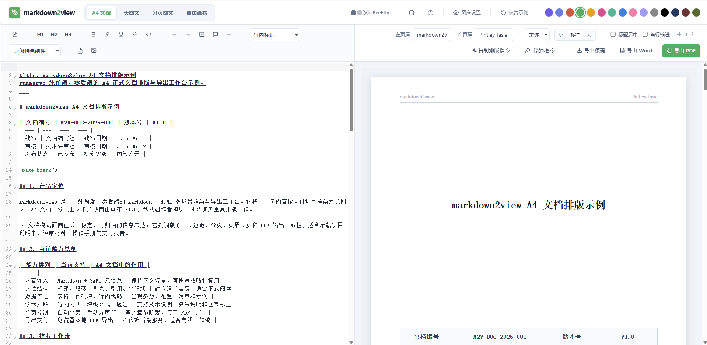
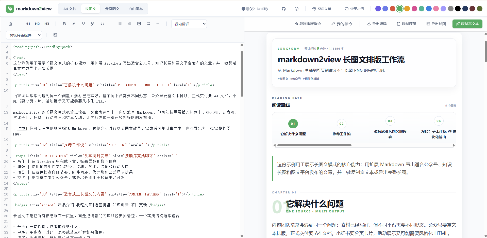
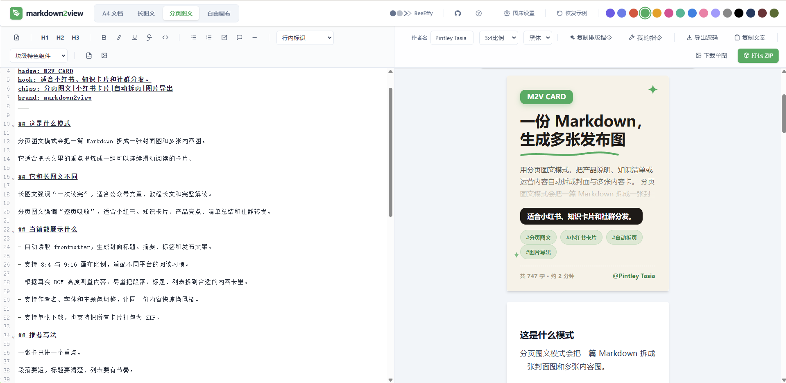
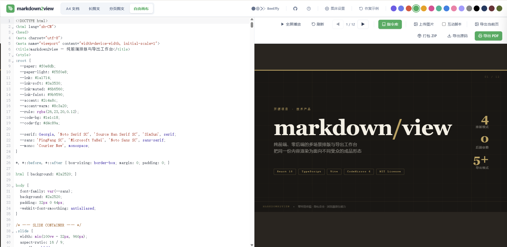

<div align="center">


# markdown2view

**Pure Frontend, Zero Backend** Markdown / HTML multi-scenario layout and export workspace.

By leveraging the built-in rendering methods of this workspace and collaborating with external AI, quickly render content into **A4 Official Document · WeChat Official Account Long Article · Xiaohongshu (RED) Image Card · Styled HTML Canvas**, and export as Rich Text / HD PNG / Vector PDF / Word (.docx) / PPT (.pptx) / Batch ZIP.

[](https://www.typescriptlang.org/)
[](https://react.dev/)
[](https://vitejs.dev/)
[](https://tailwindcss.com/)
[](https://vite-pwa-org.netlify.app/)
[](./LICENSE)

[🌐 Live Demo](https://md.beeeffy.com) · [📖 Tech Architecture](./docs/技术架构设计.md) · [🛣️ Roadmap](./docs/技术路线图.md) · [🎨 Design System](./DESIGN.md)

</div>

---

> **Design Philosophy**: Eliminate the need for backend dependencies and service deployment. By leveraging native browser rendering, W3C layout specifications, and sandbox mechanisms, it achieves ultimate content distribution and design freedom. All data remains strictly local in the browser, with **no content uploaded to third-party servers**; image hosting keys are not persisted by default. If persistence is required, they are stored encrypted via a passphrase.

## 📸 Preview

| Mode | Preview |
|:---:|:---:|
| **A4 Document** |  |
| **Long Article** |  |
| **Xiaohongshu Card** |  |
| **HTML Canvas** |  |

<details>
<summary><strong>📖 Table of Contents</strong></summary>

- [markdown2view](#markdown2view)
  - [📸 Preview](#-preview)
  - [✨ Core Features](#-core-features)
    - [🖨️ A4 Standard Document](#️-a4-standard-document)
    - [📝 Long Article Layout](#-long-article-layout)
    - [📷 Xiaohongshu (RED) Image Cards](#-xiaohongshu-red-image-cards)
    - [🎨 HTML Visual Free Canvas](#-html-visual-free-canvas)
  - [🔧 Additional Capabilities](#-additional-capabilities)
  - [🛠️ Tech Stack](#️-tech-stack)
  - [📦 Quick Start](#-quick-start)
  - [📏 Development & Commit Conventions](#-development--commit-conventions)
  - [📂 Directory Structure](#-directory-structure)
  - [🤝 Open Source References & Acknowledgments](#-open-source-references--acknowledgments)
  - [📌 Additional Notes](#-additional-notes)
  - [📄 License](#-license)

</details>

---

## ✨ Core Features

> All four modes share the same **content parsing infrastructure** and an offline workflow of "render rules → AI prompts → external AI generation → system backfill", allowing the same Markdown source file to produce distinct outputs tailored for different audience scenarios.

### 🖨️ A4 Standard Document

- **Paged.js Physical Pagination**: Based on W3C Paged Media specifications, real pagination calculations are performed within an iframe sandbox, supporting automatic page breaks and preventing orphaned headings across pages.
- **Elegant Table Cross-Page Splitting**: Tables are automatically split at page breaks, with `thead` headers repeated and labeled " (continued)".
- **`<page-break/>` Manual Pagination**: Insert page breaks directly in Markdown to precisely control cover pages, appendices, and chapter starts.
- **Evenly Distributed Cover Page**: If content before the first `<page-break/>` contains only a title and tables, it is automatically recognized as a cover page and vertically spaced evenly.
- **Custom Headers & Footers**: Supports left/right column layouts, `{page}/{total}` page number variables, first-line indentation, and font scaling.
- **Vector PDF Export**: Leverages native browser printing to output selectable/searchable vector text PDFs, with file sizes typically only tens of KB.
- **Word (.docx) Export**: Directly constructs OOXML using the `docx` library, supporting embedded formula SVGs, cover pages, headers/footers, and repeated cross-page table headers, completely independent of the preview rendering pipeline.

> ⚠️ **Known Issue**: Paged.js v0.4.3 may occasionally lose 2~3 lines of text at rare cross-page boundaries ([Upstream Issue #167](https://github.com/pagedjs/pagedjs/issues/167)). An upgrade to v0.5.0 will be tracked upon official release.

### 📝 Long Article Layout

- **WeChat Official Account Lossless Rendering**: Built-in `<steps>`, `<timeline>`, `<compare>`, and `<slider>` custom components directly reuse the WeChat article layout engine.
- **Dual Formula Engine**: Supports both MathJax and KaTeX, with built-in prefix and context validation to prevent misinterpretation of long captions.
- **Mermaid Flowcharts**: ` ```mermaid ` code blocks are automatically rendered as flowcharts, integrated into both Long Article and A4 Document modes.
- **One-Click Rich Text Copy**: Compatible with WeChat Official Account, Zhihu, Toutiao, and other editors without losing formatting.
- **Local Performance Optimization**: Input debouncing + state decoupling ensures smooth editing even for articles exceeding 10,000 words.

### 📷 Xiaohongshu (RED) Image Cards

- **Multi-Size Generation**: Optimized for Xiaohongshu publishing, supporting 3:4 and 9:16 aspect ratios with automatic numbering, author badges, and brand logos.
- **Physical Pagination Support**: Also supports `<page-break/>` for forced page turns.
- **One-Click Copy Images & Captions**: Extracts metadata from Frontmatter to intelligently generate Xiaohongshu publishing copy.
- **Non-Blocking Batch Export**: Asynchronously packages exports into a ZIP download, or exports high-definition PNGs one by one. `fflate` Web Workers compress without blocking the UI.

### 🎨 HTML Visual Free Canvas

- **Sandboxed Isolated Rendering**: `iframe` containers isolate styles, supporting imports of external styles like Tailwind CDN; script execution is disabled by default but can be manually enabled by users.
- **Web PPT Presentation**: Supports generating "Electronic Magazine Style" and "Swiss International Typographic Style" horizontal flip-page web PPTs (switchable via keyboard/gestures).
- **Unified Prompt Library**: Built-in presets for slides, resumes, reports, posters, dashboards, and multi-page social media graphics. One-click copy AI prompts for external generation.
- **HD Export**: Stable screenshot stream based on `MutationObserver`, supporting single-page PNG / PDF export and multi-page ZIP packaging.
- **PPT Export (Image-Only)**: High-definition screenshots of each page are embedded into `pptxgenjs` slide backgrounds, achieving 100% visual fidelity and adapting to any complex layout.
- **PPT Export (Editable)**: Parses DOM leaf nodes into native text boxes and images for editable text and adjustable layouts upon export (experimental).

---

## 🔧 Additional Capabilities

| Capability | Description |
|:---|:---|
| **Multiple Image Hosts** | Local / SM.MS / Alibaba Cloud OSS / Tencent Cloud COS; pasted images upload automatically and URLs are backfilled. |
| **Encrypted Vault** | Image hosting keys are not persisted by default; if persistence is required, they are stored encrypted via a passphrase in SecureVault. |
| **Custom Fonts** | A4 Document and Card modes support one-click switching between Song, FangSong, and Hei fonts. |
| **Theme Color Switching** | 5 preset theme colors (Emerald / Ocean Blue / Violet / Brick Red / Amber), driven by global CSS variables. |
| **AI Prompt Closed-Loop** | Complete "render rules → AI prompts → user action → external AI" closed loop; modifying rules automatically syncs prompts. |
| **Smart Example Sync** | `DEMO_VERSION` incremental update mechanism; system upgrades only refresh examples untouched by the user. |
| **PWA Offline Support** | Based on `vite-plugin-pwa`, supports desktop installation, offline access, and auto-updates. |
| **Browser Compatibility Check** | Automatically detects browser capabilities, displays a warning modal with suggestions if unsupported. |
| **Responsive Adaptation** | Desktop dual-column / tablet single-column / mobile drawer navigation, progressively collapsed based on `ResizeObserver`. |

---

## 🛠️ Tech Stack

| Domain | Selection |
|:---|:---|
| Framework | React 18 + TypeScript + Vite 5 |
| Editor | CodeMirror 6 (solves IME input character loss, `useMemo` caching prevents lag for 10k+ word articles) |
| State Management | Zustand v5 + `persist` local persistence |
| Styling | Tailwind CSS v4 + Vanilla CSS |
| Layout Engine | Proprietary pure TS engine (ported from r-markdown), including KaTeX / MathJax / Mermaid / highlight.js |
| A4 Pagination | Paged.js v0.4.3 (runs inside iframe sandbox) |
| Export | modern-screenshot (PNG) / Native Browser Print (PDF) / docx (Word) / pptxgenjs (PPT) / fflate (ZIP) |
| Build Optimization | `manualChunks` code splitting + dynamic imports for cloud storage SDKs + mode-level lazy loading |

> 📐 For full architecture design, see [`docs/技术架构设计.md`](./docs/技术架构设计.md); roadmap at [`docs/技术路线图.md`](./docs/技术路线图.md).

---

## 📦 Quick Start

**Requirements**: Node.js ≥ 20 (v24 recommended) · pnpm ≥ 10

```bash
# Install dependencies
pnpm install

# Start dev server (http://localhost:5173)
pnpm dev

# Type checking
pnpm typecheck

# Run tests
pnpm test

# Production build
pnpm build

# Preview build artifacts
pnpm preview
```

> 💡 If esbuild is blocked on first launch, run `pnpm rebuild esbuild`.

---

## 📏 Development & Commit Conventions

> Full guidelines available at [`docs/代码与提交规范.md`](./docs/代码与提交规范.md).

**Three pre-commit checks**:

```bash
pnpm typecheck    # 1. No type errors
pnpm test         # 2. All tests pass
pnpm build        # 3. Build succeeds without abnormal size bloat
```

**Commit Format** (Angular Convention): `<type>(<scope>): <subject>`

Types: `feat` / `fix` / `docs` / `style` / `refactor` / `perf` / `test` / `build` / `chore`

**Code Style**: Chinese comments · Keep it simple · Surgical changes · Lazy-load large SDKs · Sync prompts and rendering rules.

---

## 📂 Directory Structure

```
src/
├── engine/                # Framework-agnostic rendering engine (Markdown parsing / custom components / formulas / syntax highlighting)
├── components/
│   ├── editor/            # CodeMirror 6 editor wrapper
│   ├── layout/            # Global layout (AppHeader / ModeTabs / MobileDrawer)
│   └── ui/                # Generic UI (Button / Toast / Tooltip / ErrorBoundary, etc.)
├── modes/
│   ├── document/          # A4 document layout (Paged.js pagination + Word export)
│   ├── article/           # Long article layout (WeChat engine + rich text copy)
│   ├── card/              # Paginated image cards (multi-size + ZIP batch export)
│   └── html/              # HTML free canvas (iframe sandbox + prompt library)
├── lib/                   # Zustand store / export layer / image hosts / security / common hooks
├── data/                  # Example data + AI Prompt library
├── App.tsx                # Mode switch entry point
└── main.tsx
```

---

## 🤝 Open Source References & Acknowledgments

| Project | License | Borrowed Content |
|:---|:---|:---|
| [r-markdown](https://github.com/RobocopMao/r-markdown) | MIT | WeChat rendering engine core, custom layout components, theme color schemes |
| [html-anything](https://github.com/nexu-io/html-anything) | Apache-2.0 | iframe sandbox isolation design and export layer architecture |
| [guizang-ppt-skill](https://github.com/op7418/guizang-ppt-skill) | AGPL-3.0 | "Electronic Magazine" & "Swiss International Typographic" style references & web PPT pacing inspiration (design experience only, not merged into template source code) |

---

## 📌 Additional Notes

<details>
<summary><strong>Principles for External Resources in AI-Generated HTML</strong></summary>

Considering the network environment within China, AI-generated HTML should follow these guidelines:
- **Chinese Content**: Must not reference overseas CDNs (unpkg / jsdelivr / Google Fonts, etc.). Prioritize system font stacks and inline styles.
- **English Content**: Overseas CDNs may be used selectively, but are not recommended unless necessary.

</details>

<details>
<summary><strong>Project Language</strong></summary>

This project prioritizes Chinese and does not yet support multi-language internationalization (i18n). All project documentation and AI prompts are written in Chinese.

</details>

---

## 📄 License

[MIT License](./LICENSE)
